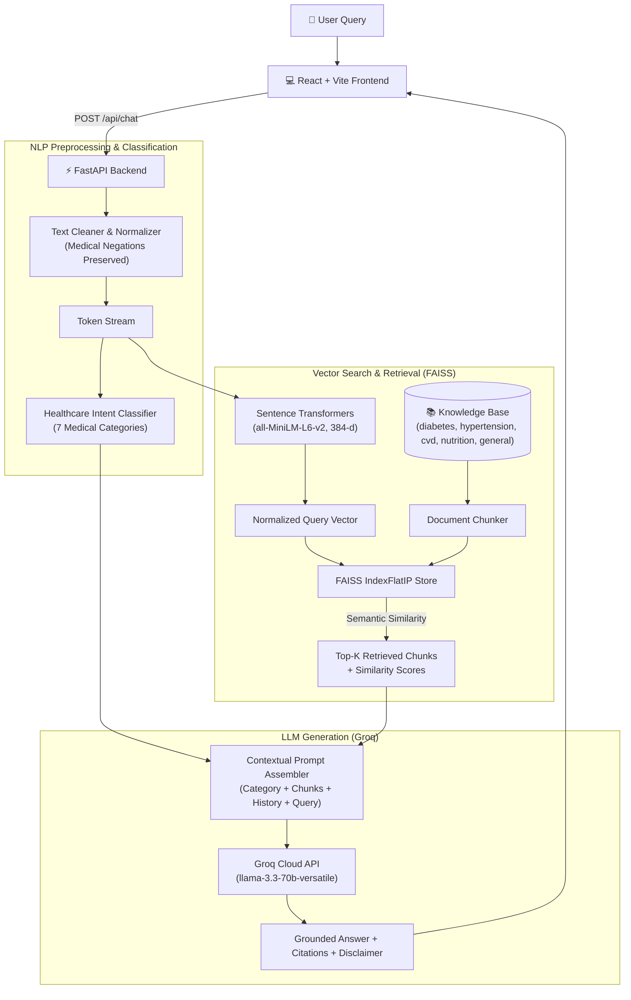

# CareFlow NLP – Healthcare Query Understanding & Intelligent Response System

[](https://github.com/Aditi-179/CareFlow-NLP)
[](https://python.org)
[](https://fastapi.tiangolo.com)
[](https://react.dev)
[](https://github.com/facebookresearch/faiss)
[](https://groq.com)

---

## 1. Project Overview

**CareFlow NLP** is an independent, lightweight healthcare Natural Language Processing (NLP) application engineered to address medical query understanding and contextual, grounded response generation. 

Built specifically to demonstrate academic concepts from **Unit 6 (Large Language Models)** alongside foundational NLP techniques (text preprocessing, tokenization, dense embeddings, and semantic vector retrieval), the system accepts unstructured natural-language clinical inquiries, categorizes user intent, extracts factually grounded evidence from a local medical knowledge base via **FAISS**, and generates safe, referenced responses through the **Groq API** (`llama-3.3-70b-versatile`).

---

## 2. Problem Statement

General-purpose Large Language Models frequently suffer from **hallucinations**, **outdated domain knowledge**, and **lack of source attribution** when answering specialized healthcare questions. In clinical contexts, incorrect assertions or omitting critical medical negations (e.g., confusing *"no chest pain"* with *"chest pain"*) can lead to dangerous misinterpretations.

CareFlow NLP solves this by implementing an end-to-end **Retrieval-Augmented Generation (RAG)** pipeline that:
1. Normalizes and tokenizes queries while **strictly preserving medical negations**.
2. Dynamically categorizes health queries into clinical domains.
3. Performs dense semantic vector matching against curated medical knowledge documents using FAISS.
4. Synthesizes answers strictly bounded by retrieved evidence, accompanied by transparent chunk citations and a visible clinical safety disclaimer.

---

## 3. Project Objectives

- **Educational & Academic Grounding:** Serve as a practical, demonstrative implementation of the Unit 6 NLP syllabus (LLM architectures, context injection, domain adaptation, prompt grounding).
- **Domain-Specific Reliability:** Prevent hallucinations through verifiable, excerpt-level source attribution.
- **Safety & Negation Awareness:** Ensure critical clinical negations (`not`, `no`, `without`, `denies`) are retained during tokenization and preprocessing.
- **Lightweight Architecture:** Eliminate complex enterprise databases or hospital management overhead in favor of a clean, reproducible NLP pipeline.

---

## 4. Key Features

- **Clinical Chatbot Interface:** Professional, responsive healthcare UI built with React, Vite, and Tailwind CSS.
- **Query Classification:** Automatic categorization into 7 healthcare domains (*Diabetes, Hypertension, Cardiovascular Health, Nutrition, Symptoms, Medication Information, General Healthcare*).
- **Medical Negation Preservation:** Preprocessing pipeline engineered to retain negation markers critical to clinical interpretations.
- **Dense Vector Search:** High-performance similarity search powered by Facebook AI Similarity Search (**FAISS**) and `sentence-transformers/all-MiniLM-L6-v2` (384-dimensional embeddings).
- **Grounded RAG Engine:** Prompt-engineered Groq LLM integration that answers queries based on retrieved clinical text chunks.
- **Transparent Source Citations:** Every response presents source documents, section headings, and similarity scores with expandable excerpt inspection.
- **Session Conversation History:** Multi-turn context memory maintained during the active session.
- **Strict Medical Disclaimer:** Prominently alerts users to educational boundaries and advises emergency triage when acute symptoms appear.

---

## 5. NLP Syllabus Alignment (Unit 6 & Core Modules)

| Syllabus Topic | Practical Implementation in CareFlow NLP |
| :--- | :--- |
| **6.1 Understanding LLMs** | Evaluates transformer attention mechanisms, token context windows, and low-temperature sampling (`T=0.2`) for factual stability. |
| **6.2 LLM Applications** | Grounded clinical question answering and multi-turn conversational dialogue. |
| **6.3 Domain Adaptation** | Context injection via RAG over curated medical literature without requiring prohibitively expensive full-model fine-tuning. |
| **6.4 Deployment & APIs** | Integration with the Groq Cloud API for ultra-low latency inference using open-weights models (`llama-3.3-70b-versatile`). |
| **6.5 Real-World Integration**| End-to-end full-stack integration connecting a React web client, FastAPI backend, FAISS vector index, and Groq inference engine. |
| **Text Preprocessing** | NLTK word tokenization, noise elimination, and explicit medical negation whitelisting (`MEDICAL_NEGATIONS`). |
| **Vectorization** | Dense semantic embedding representations via `all-MiniLM-L6-v2` (384 dimensions, cosine/inner product similarity). |
| **Information Retrieval**| FAISS dense index (`IndexFlatIP`) executing sub-millisecond semantic search. |

---

## 6. System Architecture



---

## 7. Knowledge Base Structure

The system includes 5 evidence-based reference documents:
1. `diabetes.txt`: Pathophysiology, Type 1 vs Type 2 differences, diagnostic criteria (ADA guidelines, HbA1c), SMBG monitoring, and management.
2. `hypertension.txt`: ACC/AHA blood pressure classifications, DASH diet, sodium limits, exercise, and pharmacotherapy.
3. `cardiovascular_health.txt`: Atherosclerosis, coronary artery disease, modifiable risk factors, lipid targets, and emergency warning signs.
4. `nutrition.txt`: Macronutrient quality, glycemic index, fiber mechanisms, Mediterranean diet, and electrolyte balance.
5. `general_health.txt`: Preventative screening schedules, sleep, hydration, WHO exercise targets, and emergency red-flag symptoms.

---

## 8. Technology Stack

- **Frontend:** React 18, Vite, Tailwind CSS, Lucide React
- **Backend:** Python 3.12, FastAPI, Uvicorn, Pydantic v2
- **Vector Search & Embeddings:** FAISS (`faiss-cpu`), Sentence Transformers (`all-MiniLM-L6-v2`), NumPy
- **NLP Preprocessing:** NLTK, Scikit-learn
- **LLM Provider:** Groq Cloud API (`llama-3.3-70b-versatile` / `llama-3.1-8b-instant`)

---

## 9. Installation & Local Setup

### Prerequisites
- Python 3.10+ (tested on Python 3.12)
- Node.js 18+ and npm
- A free Groq Cloud API Key from [console.groq.com](https://console.groq.com)

### 1. Clone the Repository
```bash
git clone https://github.com/Aditi-179/CareFlow-NLP.git
cd CareFlow-NLP
```

### 2. Backend Setup
```bash
cd backend

# Create and activate a Python virtual environment
python -m venv venv

# Windows:
venv\Scripts\activate
# Linux / macOS:
# source venv/bin/activate

# Install dependencies
pip install -r requirements.txt

# Configure environment variables
cp .env.example .env
# Edit .env and insert your GROQ_API_KEY
```

### 3. Run Backend Integration Tests
```bash
python tests/test_nlp_pipeline.py
```

### 4. Start the FastAPI Server
```bash
uvicorn app.main:app --host 0.0.0.0 --port 8000 --reload
```
The backend API is now running at `http://localhost:8000` (Interactive Swagger docs available at `http://localhost:8000/docs`).

### 5. Frontend Setup
Open a second terminal window:
```bash
cd CareFlow-NLP/frontend

# Install node dependencies
npm install

# Start Vite development server
npm run dev
```
The frontend is now available at `http://localhost:5173`.

---

## 10. REST API Documentation

### `POST /api/chat`
Submits a user healthcare inquiry to the RAG pipeline.
* **Request Body:**
  ```json
  {
    "query": "What are the common symptoms of diabetes?",
    "history": [
      { "role": "user", "content": "Hello" },
      { "role": "assistant", "content": "How can I help you today?" }
    ]
  }
  ```
* **Response Body:**
  ```json
  {
    "answer": "Common symptoms of diabetes include polyuria (frequent urination), polydipsia (excessive thirst), and polyphagia (persistent hunger)...",
    "category": "Diabetes",
    "category_confidence": 0.95,
    "matched_keywords": ["diabetes", "symptoms"],
    "cleaned_query": "what are the common symptoms of diabetes",
    "has_negation": false,
    "negations_found": [],
    "sources": [
      {
        "chunk_id": 2,
        "document": "diabetes.txt",
        "section": "Classic Symptoms and Warning Signs",
        "text": "The hallmark triad of diabetes symptoms includes...",
        "score": 0.8412
      }
    ],
    "total_sources": 1,
    "disclaimer": "Disclaimer: CareFlow NLP is an educational healthcare query understanding system...",
    "model_used": "llama-3.3-70b-versatile",
    "is_fallback": false
  }
  ```

### `GET /api/health`
Returns backend health status, loaded knowledge base statistics, and active models.

### `GET /api/categories`
Returns the 7 supported healthcare domain categories.

### `GET /api/knowledge-base`
Returns indexed document names, chunk counts, and FAISS vector dimensionalities.

---

## 11. Deployment Instructions

### Backend (Render / Railway / Fly.io)
1. Set the root directory to `backend`.
2. Build command: `pip install -r requirements.txt`.
3. Start command: `uvicorn app.main:app --host 0.0.0.0 --port $PORT`.
4. Add environment variables:
   - `GROQ_API_KEY`: Your Groq API key.
   - `GROQ_MODEL`: `llama-3.3-70b-versatile`.
   - `CORS_ORIGINS`: Your production frontend URL (e.g., `https://careflow-nlp.vercel.app`).

### Frontend (Vercel / Netlify)
1. Set root directory to `frontend`.
2. Build command: `npm run build`.
3. Output directory: `dist`.
4. Add environment variable:
   - `VITE_API_URL`: Your deployed backend API URL (e.g., `https://careflow-nlp-api.onrender.com/api`).

---

## 12. Limitations & Future Scope

### Limitations
- Educational knowledge base is restricted to 5 foundational chronic care categories.
- Embeddings use a CPU-optimized lightweight model (`all-MiniLM-L6-v2`); complex biomedical terminology may benefit from domain-specific encoders like BioBERT or PubMedBERT.
- Does not connect to live Electronic Health Record (EHR) systems.

### Future Scope
- Integration with PubMed / NCBI APIs for dynamic automated knowledge ingestion.
- Implementation of BioLinkBERT / Med-BERT embeddings for specialized clinical nomenclature.
- Multi-lingual translation pipeline for regional healthcare accessibility.

